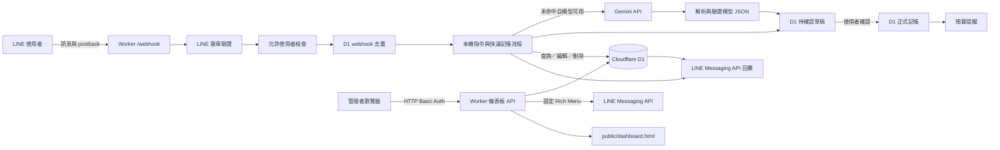

# Codegraph：LINE AI 記帳機器人

本文說明主要元件、請求流程、功能與資料／安全邊界；Worker 入口為 [`src/index.ts`](../src/index.ts)，其餘功能依領域拆分為下列模組。

## 程式模組

| 模組 | 職責 |
| --- | --- |
| [`src/index.ts`](../src/index.ts) | Worker 入口與 HTTP 路由；驗證 webhook 後交由 LINE 模組處理。 |
| [`src/line.ts`](../src/line.ts) | LINE 事件去重／處理、簽章驗證及訊息回覆。 |
| [`src/expenses.ts`](../src/expenses.ts) | 記帳對話、快速輸入、查詢、預算與新增／編輯／刪除流程。 |
| [`src/gemini.ts`](../src/gemini.ts) | Gemini API 呼叫、回應解析及模型輸出驗證。 |
| [`src/dashboard.ts`](../src/dashboard.ts) | 儀表板驗證、資料 API、匯出及 Rich Menu 設定。 |
| [`src/shared.ts`](../src/shared.ts) | 共用型別、常數、日期與格式器。 |

## 元件關係

## LINE 訊息流程

1. Worker 僅接受 `POST /webhook`；先以 `LINE_CHANNEL_SECRET` 驗證原始 request body 的 HMAC 簽章，再解析 JSON。
2. 只處理 `LINE_ALLOWED_USER_ID` 對應使用者的文字訊息與快速記帳日期 postback。若有 webhook event ID，先寫入 `processed_line_events`；重複事件不再執行。
3. 事件依序處理，以保留同一使用者連續輸入時的對話狀態順序。快速記帳狀態與本機指令優先；模型不可用時使用指令記帳，並每隔一段時間重新探測模型。
4. 需要理解自然語言時，將訊息送至 Gemini。模型回應只作為不可信輸入，必須經 JSON 欄位、日期、金額及類別驗證後才能進入業務流程。
5. 新增、編輯與刪除先建立待確認狀態；只有收到相應確認指令才會變更正式記帳。處理結果透過 LINE Reply API 回覆。
6. 若處理失敗，Worker 嘗試回覆固定錯誤訊息，並只將未處理的使用者原文與時間寫入 `unanswered_questions`；不保存一般聊天記錄或模型回覆。

## 功能導覽

| 功能 | 主要實作 |
| --- | --- |
| LINE 簽章、白名單與事件去重 | `fetch`、`verifySignature`、`processEvents` |
| 自然語言記帳與模型故障備援 | `handleMessage`、`parseMessage`、`callGeminiApi`、`runCommandFallback` |
| 快速記帳（含日期選擇器） | `handleQuickExpenseFlow`、`handleQuickExpenseDatePostback` |
| 待確認新增／編輯／刪除與復原 | `savePendingExpense`、`confirmPendingExpense`、`stageExpenseEdit`、`confirmPendingExpenseDeletion`、`restoreExpense` |
| 最近／本月／日期區間查詢、分頁與類別圖表 | `listRecentExpenses`、`getMonthlyExpensesPage`、`getExpenseSearchPage`、`getCategoryChartReply` |
| 預算與門檻提醒 | `setMonthlyBudget`、`getBudgetAlerts` |
| 私人儀表板、日期篩選、CSV／JSON 匯出 | `dashboardAuthError`、`getDashboardData`、`exportExpensesCsv`、`exportUnansweredQuestions` |
| LINE Rich Menu 建立與連結 | `setupLineRichMenu` |

### 管理儀表板路由

以下路由都由 Worker 執行 HTTP Basic Auth 檢查，且資料回應使用 `Cache-Control: no-store`：

| 方法 | 路徑 | 用途 |
| --- | --- | --- |
| `GET` | `/dashboard`、`/dashboard.html` | 提供私人儀表板 |
| `GET` | `/api/dashboard?page=1&from=YYYY-MM-DD&to=YYYY-MM-DD` | 本月摘要、分類、預算、用量、未處理問題及記帳分頁 |
| `GET` | `/api/expenses.csv` | 匯出符合日期範圍的記帳 |
| `GET` | `/api/unanswered-questions.csv`、`/api/unanswered-questions.json` | 匯出本月未處理訊息 |
| `DELETE` | `/api/expenses/{id}` | 刪除自己的記帳並建立 5 分鐘復原資料 |
| `POST` | `/api/expenses/undo` | 復原最近刪除的記帳 |
| `POST` | `/api/line-rich-menu/setup` | 建立／更新 Rich Menu 並連結至允許的使用者 |

## D1 資料表

資料表由根目錄 [`schema.sql`](../schema.sql) 建立。

| 資料用途 | 資料表 |
| --- | --- |
| 已確認支出及新增草稿 | `expenses`、`pending_expenses` |
| 刪除確認、修改確認與復原 | `pending_expense_deletions`、`pending_expense_edits`、`pending_expense_edit_targets`、`expense_undo` |
| webhook 去重與模型可用狀態 | `processed_line_events`、`bot_model_status` |
| 查詢／快速輸入的暫存狀態 | `expense_query_sessions`、`monthly_expense_list_sessions`、`quick_expense_sessions` |
| 預算、模型用量及未處理訊息 | `monthly_budgets`、`gemini_usage`、`unanswered_questions` |
| Rich Menu 設定 | `line_rich_menu_config` |

## 安全與隱私邊界

- API key、LINE channel secret／access token、允許的使用者 ID 與儀表板密碼只從 Worker secrets 或本機 `.dev.vars` 讀取；不得寫入程式碼或本文件。
- 公開版本只提供 `wrangler.toml.example` 範本；實際 `wrangler.toml`（含 D1 database ID）僅供本機使用並由 `.gitignore` 排除。
- LINE webhook 必須通過簽章驗證，且資料操作限定在 `LINE_ALLOWED_USER_ID`；儀表板及匯出 API 必須通過 Basic Auth。
- 使用者訊息會送到 Gemini API 進行解析，請依服務條款與個人隱私需求評估。請求設定 `store: false`；D1 只記錄模型名稱及 token 用量，不保存 Gemini 對話。
- `unanswered_questions` 會保存無法理解或處理的使用者原文供管理者檢視；該表在收到新問題時清除前月份資料。一般成功處理的訊息不會存入這張表。
- 匯出 CSV 時會跳脫欄位並防止公式注入；儀表板將使用者文字作為文字節點顯示，不當作 HTML 執行。

## 效能與維護重點

- D1 統計查詢在儀表板中以 `Promise.all` 平行執行；記帳查詢索引定義於 `schema.sql`。
- 台北日期格式器、報表數字格式器及固定的手動記帳解析規則在 Worker 載入時建立並重用，避免每個請求重複初始化。
- webhook 事件維持序列處理，避免並行操作覆蓋單一使用者的待確認或快速輸入狀態。
- 修改新增／刪除／編輯流程時，保留確認步驟、使用者範圍條件、event 去重及復原期限。
